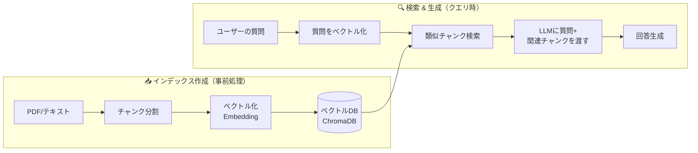
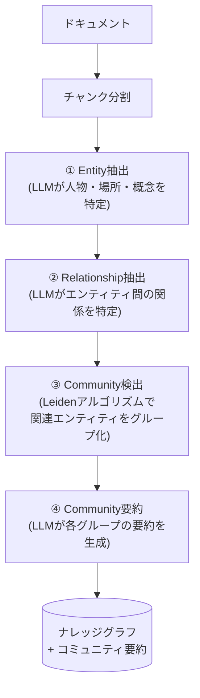
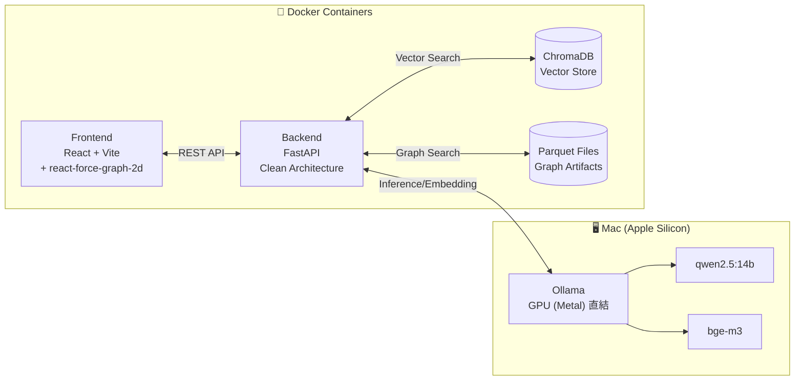

## 1. はじめに

LLM（大規模言語モデル）の登場で、「AIに質問すれば何でも答えてくれる」時代がやってきました。しかし実際に業務で使ってみると、すぐに壁にぶつかります。

- **ハルシネーション**: もっともらしいけど完全にデタラメな回答を生成する
- **知識のカットオフ**: 学習データに含まれない最新情報や社内文書には答えられない
- **根拠が不明**: 「その回答のソースはどこ？」と聞いても教えてくれない

これらを解決するアプローチとして注目されているのが **RAG（Retrieval Augmented Generation）** です。

ところが、RAGにも種類があります。従来の **Vector RAG**（ベクトル類似検索）に加え、Microsoftが2024年に発表した **GraphRAG**（ナレッジグラフ×RAG）という手法が登場しました。

> 「結局どっちを使えばいいの？」
> 「どういうケースでどちらが強いの？」
> 「そもそもGraphRAGって何が違うの？」

本記事では、これらの疑問に答えるべく、**完全ローカル環境**で Vector RAG と GraphRAG を比較検証できるツール「[local-rag-comparator](https://github.com/funayamateppei/local-rag-comparator)」を開発した経験をもとに、両者の仕組み・違い・使い分けを徹底解説します。

初学者の方でも理解できるよう基礎から説明しつつ、実践的なデータ設計のノウハウまで踏み込んでいきます。

---

## 2. RAGとは？ ― 初学者にもわかる基礎知識

### 2.1 RAGの概要

**RAG（Retrieval Augmented Generation）** を一言で説明すると、「LLMに回答させる前に、関連する情報を検索して渡す」仕組みです。

イメージとしては、こんな感じです。

> 📖 **本の索引を作って、質問に関連するページだけを開いてから回答する**

試験でカンペを使うようなものです。LLM単体だと「記憶だけで回答」しますが、RAGを使うと「参考資料を見ながら回答」できるようになります。

### 2.2 なぜRAGが必要なのか

LLM単体の限界を整理しましょう。

| 問題 | 説明 | RAGによる解決 |
|------|------|---------------|
| ハルシネーション | 事実と異なる回答を自信満々に返す | 実際のドキュメントに基づいて回答 |
| 知識のカットオフ | 学習データ以降の情報を知らない | 最新の社内文書やドキュメントを参照可能 |
| 根拠の不透明さ | 回答の出典がわからない | 参照したチャンクを一緒に返せる |
| ドメイン知識の不足 | 専門的・内部的な知識がない | 専門文書をインデックスに登録 |

### 2.3 RAGの基本パイプライン

RAGは大きく **インデックス作成（前処理）** と **検索・生成（クエリ時）** の2フェーズに分かれます。



**各ステップを簡単に解説します。**

1. **Document（ドキュメント取得）**: PDFやテキストファイルからテキストを抽出
2. **Chunk（チャンク分割）**: テキストを適切な大きさに分割（例: 500文字ずつ）
3. **Embed（ベクトル化）**: 各チャンクを数百〜数千次元の数値ベクトルに変換
4. **Store（保存）**: ベクトルをChromaDBなどのベクトルDBに格納
5. **Query（質問）**: ユーザーの質問も同じモデルでベクトル化
6. **Retrieve（検索）**: ベクトル同士のコサイン類似度で最も近いチャンクを取得
7. **Generate（生成）**: 取得したチャンクをコンテキストとしてLLMに渡し、回答を生成

### 2.4 ベクトル埋め込み（Embedding）って何？

「テキストを数値に変換」と言われてもピンとこない方のために、もう少し噛み砕きましょう。

Embeddingモデルは、テキストの**意味**を数値のリスト（ベクトル）に変換します。

```
"メロスは激怒した" → [0.12, -0.34, 0.56, 0.78, -0.91, ...]  (1024次元)
"メロスは怒った"   → [0.11, -0.33, 0.55, 0.77, -0.90, ...]  (近いベクトル!)
"今日はいい天気だ" → [0.82, 0.15, -0.43, 0.21, 0.67, ...]  (遠いベクトル)
```

意味が似ている文はベクトル空間上で近くなり、意味が異なる文は遠くなります。この性質を利用して「質問に意味的に近いチャンクを探す」のがVector RAGの核心です。

本プロジェクトでは、多言語対応の **bge-m3** をEmbeddingモデルとして使用しています。日本語テキストを扱う場合、多言語モデルの選択は特に重要です。

---

## 3. GraphRAGとは？ ― Microsoft公式のナレッジグラフ×RAG

### 3.1 GraphRAGの登場背景

2024年、Microsoft Researchは論文 **"From Local to Global: A Graph RAG Approach to Query-Focused Summarization"** を発表しました。この論文の主張は明快です。

> **従来のVector RAGは「テキストの断片」しか見ない。文書全体の構造や、エンティティ間の関係性を理解できない。**

例えば「走れメロス」で以下の質問を考えてみましょう。

- ❓ **「この物語の登場人物全員の関係性を教えて」**

Vector RAGの場合、質問に最も近い数チャンクしか取得できません。メロスとセリヌンティウスの友情について書かれたチャンクは取得できても、ディオニス王の暴政について書かれた別のチャンクは見逃すかもしれません。

GraphRAGは、文書全体からエンティティ（人物、場所、概念など）とその関係性を抽出し、**ナレッジグラフ**として構造化します。これにより、文書の「全体像」を捉えた回答が可能になります。

### 3.2 Vector RAG vs GraphRAG ― 根本的な違い

両者の違いを一言で表すと：

| | Vector RAG | GraphRAG |
|---|---|---|
| データの見方 | テキストの**断片（チャンク）** | エンティティの**構造（グラフ）** |
| 検索方法 | ベクトル類似度 | グラフ探索 + コミュニティ要約 |
| 得意な質問 | 「〇〇について教えて」 | 「〇〇と△△の関係は？」「全体像は？」 |
| 前処理コスト | 低い（Embedding計算のみ） | 高い（LLMでEntity抽出が必要） |

### 3.3 GraphRAGの仕組み ― 4つのステップ

GraphRAGのパイプラインをステップごとに見ていきましょう。



#### ① Entity抽出（エンティティ抽出）

LLMを使って、テキストから重要な概念を抽出します。

```
入力テキスト: "メロスは激怒した。必ず、かの邪智暴虐の王を除かなければならぬと決意した。"

抽出されるEntity:
  - メロス (Person): 物語の主人公。正義感の強い青年。
  - 王 / ディオニス (Person): シラクスの暴君。人を信じない。
```

#### ② Relationship抽出（関係性抽出）

エンティティ間の関係を抽出します。

```
抽出されるRelationship:
  - メロス --激怒--> ディオニス: メロスは王の暴政に対して激怒した
  - ディオニス --支配--> シラクス: ディオニスはシラクスの暴君である
  - メロス --友情--> セリヌンティウス: メロスの親友。身代わりの人質となる
```

#### ③ Community検出（コミュニティ検出）

**Leidenアルゴリズム**を使って、密接に関連するエンティティをグループ化します。

例えば：
- **Community A**: メロス、セリヌンティウス、フィロストラトス（主人公グループ）
- **Community B**: ディオニス、王城の兵士たち（権力者グループ）
- **Community C**: シラクス、メロスの村（場所グループ）

#### ④ Community要約

各コミュニティについて、LLMが要約を生成します。この要約が、後の検索で活用されます。

### 3.4 GraphRAGの2つの検索モード

Microsoft GraphRAGには2つの検索モードがあります。

**Local Search（ローカル検索）**
特定のエンティティの「近傍」をグラフから辿って、関連する情報を集めて回答します。

```
質問: "セリヌンティウスはどんな人物？"
→ セリヌンティウスノードから辿れる関係性を全て取得
→ メロスとの友情、石工としての職業、人質としての役割 etc.
```

**Global Search（グローバル検索）**
コミュニティ要約を横断的に参照し、文書全体に関わる質問に回答します。

```
質問: "この物語のテーマは何ですか？"
→ 全コミュニティの要約をMap-Reduceで統合
→ 信頼、友情、人間の善性といったテーマを総合的に回答
```

---

## 4. データ設計が精度を決める ― Entity設計の重要性

### 4.1 "What you extract determines what you can answer"

RAGの精度を上げようとすると、多くの人がまずモデルの性能やパラメータ調整に目を向けます。しかし、実際に最も精度に影響するのは **データ設計** です。

GraphRAGで言えば、**どんなEntityをどう抽出するか**が全てを決めます。

### 4.2 Entity Type（エンティティタイプ）の設計

「走れメロス」を例に、どのようなEntity Typeを定義すべきか考えてみましょう。

| Entity Type | 例 | 役割 |
|---|---|---|
| `Person` | メロス、セリヌンティウス、ディオニス | 登場人物の特定 |
| `Location` | シラクス、メロスの村 | 場所の関係性把握 |
| `Event` | 処刑命令、結婚式、帰還 | 時系列の理解 |
| `Concept` | 友情、信頼、正義 | テーマの抽出 |
| `Organization` | 王城、処刑場 | 組織・施設の関係 |

Entity Typeの粒度が粗すぎると重要な情報を見逃し、細かすぎるとノイズが増えます。ドメインに応じた適切な設計が重要です。

### 4.3 Relationship Type（関係タイプ）の設計

Entityを抽出しただけでは不十分です。**関係性のラベル**が検索品質を大きく左右します。

```
❌ 粗い設計:
  メロス --関係あり--> セリヌンティウス

✅ 適切な設計:
  メロス --友情/信頼--> セリヌンティウス
  メロス --人質を依頼--> セリヌンティウス
  セリヌンティウス --身代わり--> メロス
```

関係タイプを適切に設計することで、「メロスとセリヌンティウスの関係は？」という質問に対して、単に「関係がある」ではなく「親友であり、メロスが処刑されるまでの人質として身代わりになった」という豊かな回答が可能になります。

### 4.4 Entity抽出プロンプトの設計

本プロジェクト（local-rag-comparator）では、Entity抽出用のプロンプトをYAMLファイルで管理しています。

```yaml
name: "entity_extraction"
template: |
  以下のテキストからエンティティ（人物、場所、組織、概念など）と
  それらの関係性を抽出してください。

  テキスト:
  {{text}}

  言語: {{language}}

  以下のJSON形式で回答してください:
  {
    "entities": [
      {"name": "エンティティ名", "type": "エンティティタイプ", "description": "説明"}
    ],
    "relationships": [
      {"source": "ソースエンティティ", "target": "ターゲットエンティティ",
       "relation_type": "関係タイプ", "description": "関係の説明"}
    ]
  }
version: "1.0"
variables:
  - "text"
  - "language"
```

このプロンプトの品質が、抽出されるEntityとRelationshipの品質を直接決定します。プロンプトエンジニアリングは「モデルの調整」ではなく「データ設計」の一部です。

#### 実践的なプロンプト設計のコツ

1. **Entity Typeを明示的に列挙する**: 「人物、場所、組織、概念など」と書くだけでなく、具体的なドメインに合わせたタイプを指定
2. **出力フォーマットを厳密に指定する**: JSONスキーマを明示し、LLMが構造化データを返しやすくする
3. **Few-shot例を含める**: 実際の抽出例を1-2件プロンプトに含めることで精度が大幅に向上
4. **言語を指定する**: 多言語環境では `language` パラメータで出力言語を明示

### 4.5 チャンキング戦略

チャンクの分割方法も精度に大きく影響します。

```
❌ 悪い例: 固定文字数で機械的に分割
  "メロスは激怒した。必ず、かの邪智暴虐の王を除かなければならぬと決意した。メロスには政治がわから"
  ↑ 文の途中で切れている！

✅ 良い例: 意味的なまとまりで分割（段落・セクション単位）
  "メロスは激怒した。必ず、かの邪智暴虐の王を除かなければならぬと決意した。メロスには政治がわからぬ。メロスは、村の牧人である。"
```

チャンクサイズの設計指針：
- **小さすぎる**（100文字以下）: コンテキストが失われ、意味が不完全になる
- **大きすぎる**（2000文字以上）: ノイズが増え、関係ない情報がチャンクに混入
- **推奨**: 300-800文字程度。**チャンク間のオーバーラップ**（50-100文字）を設けると境界付近の情報を見逃しにくい

### 4.6 Embeddingモデルの選択

日本語テキストを扱う場合、Embeddingモデルの選択は特に重要です。

| モデル | 特徴 | 日本語対応 |
|---|---|---|
| `bge-m3` | 多言語対応、高品質 | ◎ |
| `text-embedding-3-small` (OpenAI) | 高品質だがAPI依存 | ○ |
| `all-MiniLM-L6-v2` | 軽量・高速だが英語中心 | △ |
| `multilingual-e5-large` | 多言語対応、大規模 | ◎ |

本プロジェクトでは **bge-m3** を採用しています。Ollamaでローカル実行でき、日本語の意味的類似度の計算精度が高いためです。

---

## 5. PDFパースの現実 ― 精度の入り口はドキュメント処理

### 5.1 Garbage In, Garbage Out

RAGの精度は、チャンクの品質 → Embeddingの品質 → 検索の品質 → 回答の品質、と連鎖します。この連鎖の**最上流**にあるのがドキュメントのパース（テキスト抽出）です。

パースが汚ければ、その後どれだけ優れたモデルを使っても精度は上がりません。

### 5.2 テキスト抽出の選択肢

Pythonで利用できる主なPDFパースライブラリを比較します。

| ライブラリ | 特徴 | 速度 | テキスト品質 |
|---|---|---|---|
| **PyMuPDF (fitz)** | 高速、レイアウト情報も取得可能 | ◎ | ○ |
| **pdfplumber** | テーブル抽出に強い | ○ | ○ |
| **PyPDF2** | 軽量だが機能は限定的 | ○ | △ |
| **Unstructured** | 複数フォーマット対応、前処理充実 | △ | ◎ |
| **LlamaParse** | LLMベース、高精度だがAPI依存 | △ | ◎ |

本プロジェクトでは **PyMuPDF** を基本ライブラリとして採用しています。ローカル完結で高速に動作し、ページ単位のメタデータも取得できるためです。

### 5.3 クリーンなテキスト抽出のための課題

PDFからのテキスト抽出には、見過ごされがちな落とし穴がたくさんあります。

#### ヘッダー・フッター・ページ番号の混入

```python
# ❌ 生の抽出結果
"""
Copyright 2024 Company Inc.
- 42 -
第3章 システム設計
3.1 アーキテクチャ概要
本システムは...
Copyright 2024 Company Inc.
- 43 -
"""

# ✅ クリーニング後
"""
第3章 システム設計
3.1 アーキテクチャ概要
本システムは...
"""
```

繰り返し出現するヘッダー/フッターはパターンマッチングで除去可能ですが、ドキュメントごとにフォーマットが異なるため、汎用的な処理は難しいのが現実です。

#### 段組みレイアウトの処理

2段組みのPDFでは、左列と右列のテキストが交互に混ざって抽出されることがあります。PyMuPDFの `sort` オプションやレイアウト解析機能を活用することで、ある程度の改善は可能です。

### 5.4 テーブル抽出 ― 最大の難関

PDFのテーブル（表）は、RAGにおける**最大の課題の一つ**です。

#### なぜテーブルが難しいのか

PDFの内部構造を理解すると、この問題の根深さがわかります。PDFには「テーブル」という概念が存在しません。テーブルに見えるものは、実際には**個別に配置されたテキストと線の集合**です。

```
PDFの内部表現（概念的）:
  Text("売上", x=100, y=200)
  Text("1000", x=250, y=200)
  Text("利益", x=100, y=230)
  Text("300", x=250, y=230)
  Line(x1=80, y1=190, x2=300, y2=190)
  Line(x1=80, y1=220, x2=300, y2=220)
  ...
```

これを「テーブル」として認識し、正しくパースするのは本質的に難しい問題です。

#### 特に厄介なケース

- **セル結合**: 行や列がマージされているテーブル
- **複数行セル**: 1つのセル内にテキストが折り返されている
- **罫線なしテーブル**: スペースやタブで整列されただけのテーブル
- **ネストしたテーブル**: テーブルの中にテーブルがある

#### テーブル抽出の現状と選択肢

```python
# pdfplumberによるテーブル抽出
import pdfplumber

with pdfplumber.open("document.pdf") as pdf:
    for page in pdf.pages:
        tables = page.extract_tables()
        for table in tables:
            # table は [行][列] の2次元リスト
            for row in table:
                print(row)
```

| ツール | アプローチ | 強み | 限界 |
|---|---|---|---|
| **pdfplumber** | ルールベース | 罫線のあるテーブルに強い | 罫線なしテーブルに弱い |
| **Camelot** | 画像処理+ルール | 精度が高い | 設定が複雑 |
| **Tabula** | Java連携 | 実績がある | 日本語に弱い場合がある |
| **Table Transformer** | 深層学習 | 汎用性が高い | 計算コストが高い |
| **GPT-4V / LLM** | マルチモーダル | 複雑なレイアウトも理解可能 | コスト大・速度遅 |

**現時点の現実的な結論**: 完璧なテーブル抽出ツールは存在しません。ドキュメントの種類に応じてツールを使い分けるか、テーブルはMarkdown形式に手動変換してからインデックスに投入するのが最も確実です。

### 5.5 画像・図の処理

PDFに含まれる画像や図表も、テキスト抽出では失われます。

- **OCR（光学文字認識）**: Tesseractなどで画像内のテキストを抽出
- **マルチモーダルモデル**: GPT-4V、LLaVAなどで画像の内容を説明テキストに変換
- **現実的な対応**: 重要な図表にはキャプションやaltテキストを手動で追加

### 5.6 ベストプラクティスまとめ

1. **前処理を丁寧に**: ヘッダー/フッター除去、不要な改行の正規化、文字化け修正
2. **意味的なセクション分割**: 章・節・段落を意識した分割（固定文字数分割は避ける）
3. **メタデータの保存**: セクションタイトル、ページ番号、階層構造を保持
4. **テーブルは別処理**: 通常のテキスト抽出とは別にテーブル専用の処理を行う
5. **品質チェック**: パース結果を目視確認し、問題があれば前処理を調整

---

## 6. アーキテクチャ ― 完全ローカル比較検証システムの設計

### 6.1 なぜ完全ローカルなのか

本プロジェクト「local-rag-comparator」は、以下の理由から完全ローカル環境で動作する設計を採用しています。

- **プライバシー**: 機密文書を外部APIに送信しない
- **コスト**: OpenAI APIの従量課金を気にせず何度でも実験可能
- **再現性**: 同じモデル・同じ設定で、いつでも同じ結果を再現できる
- **学習**: RAGの仕組みを手元で完全に把握できる

### 6.2 技術スタック



| コンポーネント | 技術 | 役割 |
|---|---|---|
| LLM | Ollama + qwen2.5:14b | 推論・Entity抽出・回答生成 |
| Embedding | Ollama + bge-m3 | テキストのベクトル化 |
| Backend API | FastAPI | クリーンアーキテクチャに基づくAPI |
| Vector DB | ChromaDB | ベクトル検索（Vector RAG） |
| Graph Storage | Apache Parquet | ナレッジグラフの永続化（GraphRAG） |
| Frontend | React + react-force-graph-2d | UI + グラフ可視化 |
| File Watcher | watchdog | ファイル配置の検知・自動処理 |

### 6.3 ハイブリッド・コンテナ設計

本プロジェクトのユニークな点は、**OllamaだけMacネイティブで実行**し、残りはDockerコンテナで動かすハイブリッド構成です。

```
なぜ？
→ OllamaをDocker内で動かすと、Metal (Apple GPU) にアクセスできない
→ qwen2.5:14b の推論速度が CPU only になり、実用的ではなくなる
→ そこで Ollama だけはホスト上で起動し、Docker コンテナからは
   host.docker.internal:11434 でアクセスする
```

この設計により、14Bパラメータのモデルでもストレスのない推論速度を実現しています。

### 6.4 クリーンアーキテクチャ + DDD

バックエンドは、クリーンアーキテクチャの原則に従って設計しています。

```
backend/src/
├── domain/          # エンティティ・値オブジェクト・リポジトリインターフェース
│   ├── models/
│   │   ├── document.py      # Document Entity (状態遷移を持つ集約ルート)
│   │   ├── graph_data.py    # Entity, Relationship, GraphData (不変値オブジェクト)
│   │   ├── query_result.py  # QueryResult
│   │   └── prompt.py        # PromptTemplate
│   └── repositories.py      # IDocumentRepository, IVectorRepository, IGraphRepository
├── application/     # ユースケース
│   └── use_cases/
│       ├── document_processor.py  # ドキュメント処理のオーケストレーション
│       └── compare_rag.py         # Vector RAG vs GraphRAG 比較実行
├── infrastructure/  # 外部サービスとの接続実装
│   ├── vector_repository.py   # ChromaDB実装
│   ├── graph_repository.py    # Parquetベースの実装
│   ├── ollama_service.py      # Ollama API連携
│   ├── file_parser.py         # PDF/テキスト パーサー
│   └── file_watcher.py        # watchdogによるファイル監視
├── interfaces/      # FastAPI Router
│   ├── routers/
│   │   ├── query.py           # クエリAPI
│   │   └── upload.py          # アップロードAPI
│   └── schemas.py             # リクエスト/レスポンススキーマ
└── core/            # 設定・プロンプト管理
    └── prompts/
        ├── entity_extraction.yaml
        ├── search_query.yaml
        └── summarization.yaml
```

**設計のポイント:**

- **ドメイン層は外部依存ゼロ**: ChromaDBやOllamaへの依存はインフラ層に閉じ込め
- **リポジトリパターン**: `IVectorRepository`, `IGraphRepository` などのインターフェースで抽象化
- **Document Entity**: 状態遷移（UPLOADED → PROCESSING → PARSED → INDEXED）をドメインモデルで表現

```python
# ドメインモデル: GraphData（不変値オブジェクト）
@dataclass(frozen=True)
class Entity:
    name: str        # "メロス"
    type: str        # "Person"
    description: str # "物語の主人公。正義感の強い青年。"

@dataclass(frozen=True)
class Relationship:
    source: str        # "メロス"
    target: str        # "セリヌンティウス"
    relation_type: str # "友情"
    description: str   # "メロスの親友。身代わりの人質となる。"
```

### 6.5 TDD（テスト駆動開発）

本プロジェクトでは、t-wada氏の提唱する **Red → Green → Refactor** サイクルに従ってTDDを実践しています。

```
tests/
├── unit/
│   ├── domain/          # ドメインモデルのテスト
│   ├── application/     # ユースケースのテスト
│   ├── infrastructure/  # インフラ層のテスト（モック使用）
│   └── interfaces/      # Router/Schemaのテスト
└── integration/         # 結合テスト
```

ドメイン層とアプリケーション層は外部依存がないため、高速なユニットテストが可能です。インフラ層はモックを使ってテストし、実際のChromaDBやOllamaとの結合は統合テストで検証します。

---

## 7. Vector RAG vs GraphRAG ― 比較検証

### 7.1 テストセットアップ

**テストドキュメント**: 太宰治「走れメロス」（青空文庫より）

選定理由：
- 日本語テキストの標準的なベンチマーク
- 明確な登場人物と関係性を持つ
- テーマや寓意があり、抽象的な質問の検証にも適している
- 著作権の問題がない

**モデル構成**:
- LLM: qwen2.5:14b（Ollama）
- Embedding: bge-m3（Ollama）
- Vector DB: ChromaDB
- Graph Storage: Parquet（Microsoft GraphRAG準拠）

### 7.2 クエリカテゴリ別の比較

5つのカテゴリでクエリを検証しました。

#### カテゴリ1: 事実に基づく質問（Factual）

**Q: 「メロスはなぜ激怒したのか？」**

| | Vector RAG | GraphRAG (Local Search) |
|---|---|---|
| 回答品質 | ⭐⭐⭐⭐ | ⭐⭐⭐⭐ |
| 根拠の正確性 | 該当チャンクをピンポイントで取得 | Entity「ディオニス」の近傍から関連情報を取得 |
| 回答速度 | 約2秒 | 約5秒 |

**所感**: 事実に基づく単純な質問では、Vector RAGが速度・品質ともに優秀。チャンクの類似度検索が質問のキーワードとよくマッチするため。

#### カテゴリ2: 関係性の質問（Relationship）

**Q: 「メロスとセリヌンティウスの関係を詳しく教えてください」**

| | Vector RAG | GraphRAG (Local Search) |
|---|---|---|
| 回答品質 | ⭐⭐⭐ | ⭐⭐⭐⭐⭐ |
| 根拠の正確性 | 一部のチャンクしか取得できず、関係の全体像が欠ける | グラフを辿ることで複数の関係性を網羅 |
| 回答速度 | 約2秒 | 約6秒 |

**所感**: GraphRAGの真価が発揮される場面。Vector RAGでは「友情」について書かれたチャンクは取得できても、「人質としての役割」や「石工という職業」に関する別チャンクを見逃しがち。GraphRAGはセリヌンティウスノードから関係性を辿ることで、網羅的な回答が可能。

#### カテゴリ3: 推論が必要な質問（Reasoning）

**Q: 「ディオニス王が最終的に改心した理由は何だと考えられますか？」**

| | Vector RAG | GraphRAG (Local Search) |
|---|---|---|
| 回答品質 | ⭐⭐⭐ | ⭐⭐⭐⭐ |
| 根拠の正確性 | 結末のチャンクは取得できるが、物語全体の流れを把握しにくい | 関連エンティティの関係を辿り、因果関係を推論可能 |
| 回答速度 | 約2秒 | 約7秒 |

#### カテゴリ4: 抽象的な質問（Abstract）

**Q: 「この物語のテーマは何ですか？」**

| | Vector RAG | GraphRAG (Global Search) |
|---|---|---|
| 回答品質 | ⭐⭐ | ⭐⭐⭐⭐⭐ |
| 根拠の正確性 | 「テーマ」というキーワードに類似するチャンクが少ない | コミュニティ要約を横断的に参照し、全体像を把握 |
| 回答速度 | 約2秒 | 約12秒 |

**所感**: 文書全体に関わる抽象的な質問では、GraphRAGのGlobal Searchが圧倒的に強い。Vector RAGは特定のチャンクしか参照できないため、物語全体のテーマを語ることが難しい。

#### カテゴリ5: 時系列・順序の質問（Sequential）

**Q: 「メロスが城に向かってから処刑場に到着するまでの出来事を時系列で教えてください」**

| | Vector RAG | GraphRAG (Local Search) |
|---|---|---|
| 回答品質 | ⭐⭐ | ⭐⭐⭐⭐ |
| 根拠の正確性 | 時系列の一部のチャンクしか取得できない | Eventエンティティの関係性から時系列を再構成 |
| 回答速度 | 約2秒 | 約8秒 |

### 7.3 総合比較

| 評価軸 | Vector RAG | GraphRAG |
|---|---|---|
| **事実質問の精度** | ⭐⭐⭐⭐ | ⭐⭐⭐⭐ |
| **関係性質問の精度** | ⭐⭐⭐ | ⭐⭐⭐⭐⭐ |
| **抽象質問の精度** | ⭐⭐ | ⭐⭐⭐⭐⭐ |
| **推論質問の精度** | ⭐⭐⭐ | ⭐⭐⭐⭐ |
| **応答速度** | ⭐⭐⭐⭐⭐ | ⭐⭐ |
| **インデックス作成速度** | ⭐⭐⭐⭐⭐ | ⭐⭐（LLMでEntity抽出） |
| **ストレージ効率** | ⭐⭐⭐⭐ | ⭐⭐⭐ |
| **セットアップの容易さ** | ⭐⭐⭐⭐⭐ | ⭐⭐⭐ |

### 7.4 重要な発見

**1. どちらが優れているかは「質問の種類」による**

Vector RAGが得意な領域とGraphRAGが得意な領域は明確に異なります。どちらか一方が「常に優れている」ということはありません。

**2. GraphRAGのインデックス作成コストは無視できない**

GraphRAGは、全チャンクに対してLLMでEntity抽出を行う必要があります。「走れメロス」程度の短い文書でも、インデックス作成に数分かかりました。大量のドキュメントを扱う場合、このコストは重要な検討事項です。

**3. Vector RAGの「チャンクの壁」問題**

Vector RAGは、どれだけ優れたEmbeddingモデルを使っても、「チャンクの境界を超えた情報」を扱うことが構造的に難しいです。複数のチャンクに散在する情報を統合する必要がある質問には弱い。

**4. データ設計が結果を支配する**

GraphRAGの精度は、Entity抽出プロンプトの品質に大きく依存します。適切なEntity TypeとRelationship Typeを設計しないと、グラフの構造が不十分になり、検索品質が低下します。

---

## 8. 精度を上げるために ― 実践的なTips

### 8.1 Entity抽出プロンプトのチューニング

最も効果が高いのは、Entity抽出プロンプトの改善です。

```yaml
# 改善前: 汎用的すぎる
template: "テキストからエンティティを抽出してください"

# 改善後: ドメイン特化 + Few-shot
template: |
  あなたは文学作品の分析エキスパートです。
  以下のテキストから、物語を理解するために重要なエンティティと関係性を抽出してください。

  ## Entity Types
  - Person: 登場人物（名前、役職、性格的特徴）
  - Location: 場所（地名、建物、自然の場所）
  - Event: 重要な出来事（行動、事件、転換点）
  - Concept: 抽象的な概念（テーマ、感情、価値観）

  ## 例
  テキスト: "メロスは激怒した。必ず、かの邪智暴虐の王を除かなければならぬと決意した。"
  Entities:
    - {name: "メロス", type: "Person", description: "主人公。正義感が強い牧人"}
    - {name: "ディオニス", type: "Person", description: "シラクスの暴君。邪智暴虐と描写される"}
    - {name: "激怒", type: "Event", description: "メロスが王の暴政を知り激怒した出来事"}
  Relationships:
    - {source: "メロス", target: "ディオニス", relation_type: "敵対",
       description: "メロスは王の暴政に対して激怒し、除くことを決意した"}
```

### 8.2 チャンクオーバーラップ戦略

チャンクの境界で情報が失われる問題を軽減するために、オーバーラップを設けます。

```python
def chunk_with_overlap(text: str, chunk_size: int = 500, overlap: int = 100) -> list[str]:
    """オーバーラップ付きチャンク分割"""
    chunks = []
    start = 0
    while start < len(text):
        end = start + chunk_size
        chunk = text[start:end]
        chunks.append(chunk)
        start = end - overlap  # overlapの分だけ戻って次のチャンクを開始
    return chunks
```

### 8.3 ハイブリッドアプローチ ― 両方使う

実は、Vector RAGとGraphRAGは**併用**できます。

```python
async def hybrid_query(question: str) -> str:
    """Vector RAGとGraphRAGの両方で検索し、最良の回答を選択"""
    # 並行して両方の検索を実行
    vector_results = await vector_repository.search(query_embedding, top_k=5)
    graph_results = await graph_repository.search(question)

    # 両方の結果をコンテキストとしてLLMに渡す
    combined_context = format_results(vector_results, graph_results)

    # LLMに最終回答を生成させる
    response = await llm.generate(
        prompt=f"""
        以下の2つの検索結果を元に、質問に回答してください。
        情報が矛盾する場合は、より詳細で根拠が明確な方を優先してください。

        【Vector検索結果】
        {vector_results}

        【Graph検索結果】
        {graph_results}

        質問: {question}
        """
    )
    return response
```

このアプローチにより、事実質問にはVector RAGの結果が、関係性・抽象的質問にはGraphRAGの結果が自然に活用されます。

### 8.4 検索結果のリランキング

取得したチャンクの順序を、より精度の高い方法で並べ替えます。

```
1. 初期検索: Embeddingの類似度で top-20 を取得（広めに取る）
2. リランキング: Cross-Encoderモデルで質問とチャンクのペアをスコアリング
3. 最終選択: リランキング後の top-5 をLLMに渡す
```

Cross-Encoderはbi-encoder（通常のEmbedding）より精度が高いですが、計算コストも高いため、初期検索で候補を絞ってから適用するのがポイントです。

### 8.5 ナレッジグラフの反復的改善

GraphRAGのナレッジグラフは一度作ったら終わりではありません。

1. **初回抽出**: LLMでEntity/Relationshipを抽出
2. **品質評価**: 抽出結果を確認し、不足や誤りを特定
3. **プロンプト改善**: 抽出プロンプトを調整
4. **再抽出**: 改善したプロンプトで再度Entity抽出
5. **繰り返し**: 品質が十分になるまで反復

本プロジェクトのフロントエンドでは **react-force-graph-2d** を使ってナレッジグラフを可視化しています。これにより、「抽出されたEntityは適切か」「重要な関係性が欠けていないか」を視覚的に確認できます。

---

## 9. まとめ

### RAGとGraphRAGは競合ではなく補完関係

本記事を通じて伝えたかったことは、以下の3点です。

**1. Vector RAGとGraphRAGは「どちらが優れているか」ではなく「どう使い分けるか」**

事実ベースの単純な質問にはVector RAG、関係性・全体像に関する質問にはGraphRAGが強いです。両者を組み合わせるハイブリッドアプローチが現時点での最適解です。

**2. RAG手法の選択よりも「データ設計」が重要**

Entity Typeの設計、Relationship Typeの設計、チャンキング戦略、PDFパースの品質。これらの「データ設計」が、RAGの精度を最も大きく左右します。最新のモデルに飛びつく前に、まずデータの品質を見直しましょう。

**3. PDFパース（特にテーブル）は依然として困難な問題**

"Garbage in, garbage out" の原則は、RAGにおいてもそのまま当てはまります。ドキュメントのパース品質は、下流の全てのプロセスに影響します。テーブル抽出は特に難しく、現時点では完璧なソリューションは存在しません。

### 今後の展望

- **ハイブリッドRAGの標準化**: Vector + Graph を統合的に扱うフレームワークの成熟
- **マルチモーダルRAG**: 画像・図表を含むドキュメントの理解
- **Agentic RAG**: LLMが自律的に「どの検索手法を使うか」を判断するアプローチ
- **ローカルLLMの進化**: より小さなモデルでGraphRAG品質のEntity抽出が可能に

### プロジェクトリンク

本記事で紹介した比較検証ツールのソースコードは以下のリポジトリで公開しています。

👉 **[local-rag-comparator](https://github.com/funayamateppei/local-rag-comparator)**

完全ローカルで動作するため、手元のMac（Apple Silicon）があれば `make setup && make up` だけで環境構築から検証開始まで行えます。ぜひ実際に触ってみてください。

---

**最後まで読んでいただきありがとうございました。** この記事が、RAGの手法選択やデータ設計で悩んでいる方の助けになれば幸いです。質問やフィードバックがあれば、GitHubのIssueやZennのコメントでお気軽にどうぞ。
